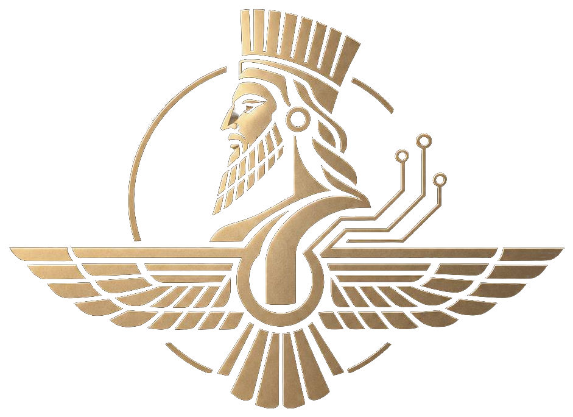

<div align="center">


</div>

<table align="center">
<tr>
<td align="center" valign="middle" width="280">



</td>
<td valign="middle">


<br>

I turn ideas into working projects.<br>
Python, computer vision, data and databases — **learn, build, improve.**

<br>

<a href="https://github.com/mamirabadi1389-lang">

</a>
<a href="https://t.me/Pyforever4554">

</a>

<br><br>


</td>
</tr>
</table>


<h2 align="center">⟦ ABOUT ME ⟧</h2>

```python
class MohammadAmirabadi:

    def __init__(self):
        self.name = "Mohammad Amirabadi"
        self.role = "Python Developer"
        self.interests = [
            "Python Development",
            "Machine Learning",
            "Data Analysis",
            "Database Systems",
            "Web Development",
        ]

    def goal(self):
        return "Learn, build, and improve."
```


<h2 align="center">⟦ TECH STACK ⟧</h2>

<div align="center">


<br><br>


</div>


<h2 align="center">⟦ FEATURED PROJECTS ⟧</h2>

<table>
<tr>
<td width="50%" valign="top">


### 🖐 Hand Gesture Control

Controls Windows volume using hand gestures.

`Python` `OpenCV` `MediaPipe`

<a href="https://github.com/mamirabadi1389-lang/gesture-volume-control"></a>

</td>
<td width="50%" valign="top">


### 🧬 Cancer Diagnosis

A machine learning classification project on cancer-related data.

`Python` `Machine Learning`

<a href="https://github.com/mamirabadi1389-lang/Cancer-diagnosis"></a>

</td>
</tr>
<tr>
<td width="50%" valign="top">


### 🍃 Pandas & MongoDB

Processes CSV files and imports the data into MongoDB.

`Python` `Pandas` `MongoDB`

<a href="https://github.com/mamirabadi1389-lang/pandas_and_MongoDB"></a>

</td>
<td width="50%" valign="top">


### 🗓 Daily Planner

Organizes daily tasks and activities.

`Python`

<a href="https://github.com/mamirabadi1389-lang/daily_planner"></a>

</td>
</tr>
</table>


<h2 align="center">⟦ CURRENTLY LEARNING ⟧</h2>

<div align="center">


</div>


<h2 align="center">⟦ GITHUB STATS ⟧</h2>

<div align="center">


<br><br>


</div>

<br>

<div align="center">


### KOUROSH SYSTEM

<sub>Personal Brand & Software Projects</sub>

<br>

<code>BUILD · LEARN · IMPROVE</code>

<br><br>

<sub>Thanks for visiting my profile.</sub>

</div>
